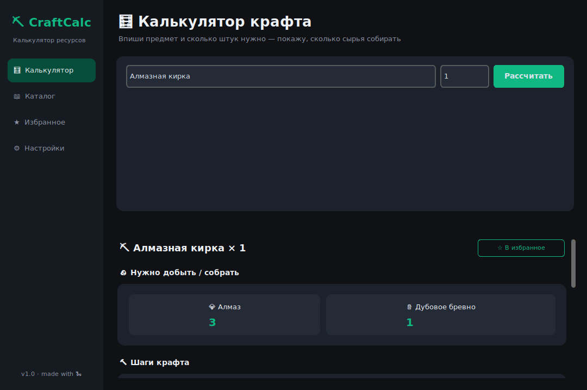
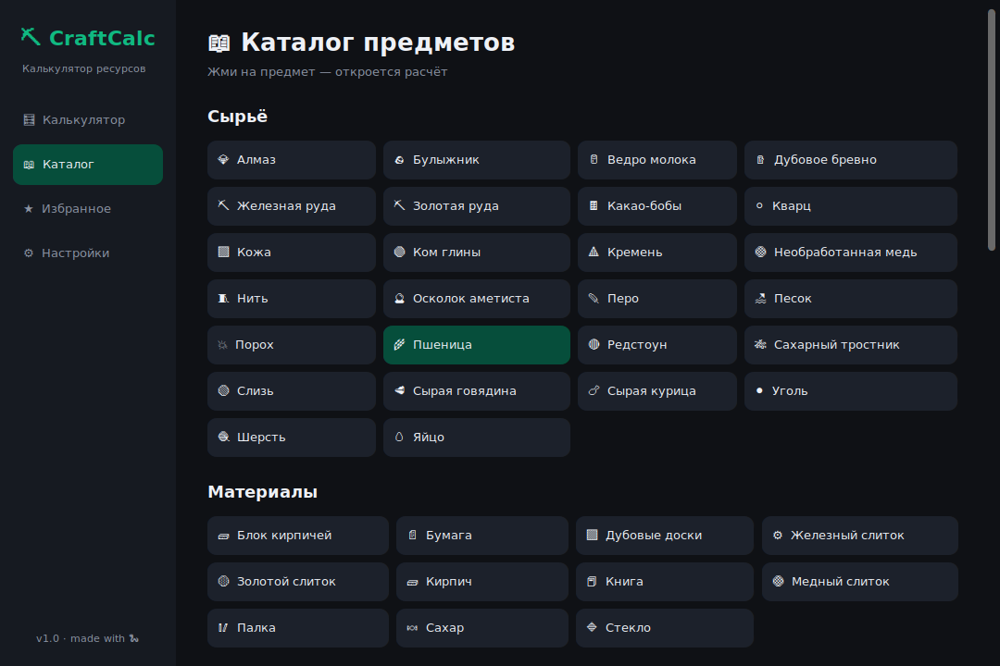

# ⛏️ Minecraft Craft Calculator — Recursive Recipe Solver & Resource Planner

<p align="center">
  
  
  
  
  
</p>

<p align="center">
  <b>Minecraft Craft Calculator</b> — автономное десктопное приложение для точного расчета сырья и этапов крафта в Minecraft.<br/>
  <i>Вы вводите желаемый предмет и его количество — калькулятор мгновенно рассчитывает базовое сырье (руду, бревна, слитки), строит визуальное дерево крафта и раскладывает процесс по шагам.</i>
</p>

---

## 📸 Скриншоты интерфейса

| 🧮 Интерактивный калькулятор | 🗂️ Каталог предметов по категориям |
|:---:|:---:|
|  |  |

---

## 📋 Содержание

- [💡 О проекте и решаемая задача](#-о-проекте-и-решаемая-задача)
- [✨ Возможности](#-возможности)
- [🧮 Как работает алгоритм расчета](#-как-работает-алгоритм-расчета)
- [🛠 Стек технологий](#-стек-технологий)
- [📥 Установка и запуск](#-установка-и-запуск)
- [➕ Как добавить свой предмет или рецепт](#-как-добавить-свой-предмет-или-рецепт)
- [🏗 Структура проекта](#-структура-проекта)
- [📜 Лицензия](#-лицензия)

---

## 💡 О проекте и решаемая задача

При возведении масштабных построек или крафте сложной экипировки в Minecraft игрокам приходится в уме высчитывать цепочки промежуточных крафтов: *«Сколько бревен нужно срубить, чтобы получить 6 сундуков, если из 1 бревна получается 4 доски, а на 1 сундук нужно 8 досок?»*.

**Minecraft Craft Calculator решает эту задачу автоматически:**
- Учитывает партионность рецептов (кратность выхода предметов).
- Округляет партии строго вверх, предотвращая нехватку ресурсов.
- Раскладывает сложные многосоставные предметы (поршни, редстоун-схемы, броню, рельсы) до абсолютного первичного сырья (сырой железной руды, дубовых бревен, редстоун-пыли, алмазов).

---

## ✨ Возможности

- 🌳 **Рекурсивный разбор дерева крафта:**
  - Любой предмет автоматически декомпозируется до некрафтового сырья.
  - Наглядное раскрывающееся интерактивное дерево крафта со счетчиком шагов.
- 📋 **Пошаговый план крафта:**
  - Четкий список действий: сколько именно раз нужно скрафтить каждый промежуточный компонент.
- 📦 **Встроенная база из 97 ванильных предметов:**
  - Инструменты, оружие, комплекты брони, механизмы (поршни, воронки, раздатчики), еда, транспорт, базовые строительные материалы.
- 🔍 **Умный поиск с подсказками (Live Search):**
  - Моментальный автокомплит при вводе названия предмета.
- 🗃️ **Каталог по категориям:**
  - Удобный браузер предметов с иконками и фильтрацией в один клик.
- ⭐ **Избранное и история расчетов:**
  - Сохранение часто используемых крафтов для быстрого повторного доступа.
- 🎨 **Кастомизация интерфейса:**
  - Переключение светлой и темной темы оформления, выбор из 5 акцентных цветов интерфейса.

---

## 🧮 Как работает алгоритм расчета

Для каждого рецепта движок рекурсивно обходит зависимости графа предметов:

$$\text{craft\_count} = \left\lceil \frac{\text{нужное количество}}{\text{выход за один крафт}} \right\rceil$$

Если рецепт дает предметов больше, чем требуется на текущем шаге (например, 4 доски из 1 бревна, когда нужно всего 3), калькулятор округляет партию вверх и учитывает остаток при дальнейших подсчетах.

---

## 🛠 Стек технологий

- **[Python 3.10+](https://www.python.org/)** — основная логика и алгоритмы графов
- **[CustomTkinter](https://github.com/TomSchimansky/CustomTkinter)** — современный интерфейс с плавной анимацией виджетов
- **JSON Data Store** — легко расширяемая база предметов и рецептов без необходимости в СУБД

---

## 📥 Установка и запуск

```bash
# 1. Клонируйте репозиторий
git clone https://github.com/kemranbatcaev02-gif/craft-calculator.git
cd craft-calculator

# 2. Установите зависимости
pip install -r requirements.txt

# 3. Запустите приложение
python main.py
```

---

## ➕ Как добавить свой предмет или рецепт

База рецептов открыта для редактирования в `data/items.json` и `data/recipes.json`:

```json
// data/items.json
"custom_sword": {
  "name": "Меч Победителя",
  "category": "Оружие",
  "icon": "⚔️"
}

// data/recipes.json
"custom_sword": {
  "yield": 1,
  "ingredients": {
    "diamond": 2,
    "stick": 1
  }
}
```

---

## 🏗 Структура проекта

```text
craft-calculator/
├── main.py                          # Главное окно, навигация, маршрутизация
├── requirements.txt                 # Зависимости проекта
├── LICENSE                          # Лицензия MIT
├── screenshots/                     # Иллюстрации для документации
├── app/
│   ├── config.py                    # Настройки тем, история, избранное (JSON)
│   ├── calculator.py                # Рекурсивный алгоритм декомпозиции рецептов
│   └── ui/
│       ├── theme.py                 # Палитра светлой и темной темы
│       ├── widgets.py               # Кастомные карточки и кнопки
│       ├── tree_view.py             # Виджет интерактивного дерева крафта
│       ├── calculator_page.py       # Главный экран расчета сырья
│       ├── browser_page.py          # Каталог предметов с фильтрами
│       ├── favorites_page.py        # Экран сохраненных расчетов
│       └── settings_page.py         # Настройки цветовой гаммы
└── data/
    ├── items.json                   # Реестр предметов (название, категория, иконка)
    └── recipes.json                 # Дерево рецептов (выход + список ингредиентов)
```

---

## 📜 Лицензия

Проект распространяется под свободной лицензией **[MIT](LICENSE)**.